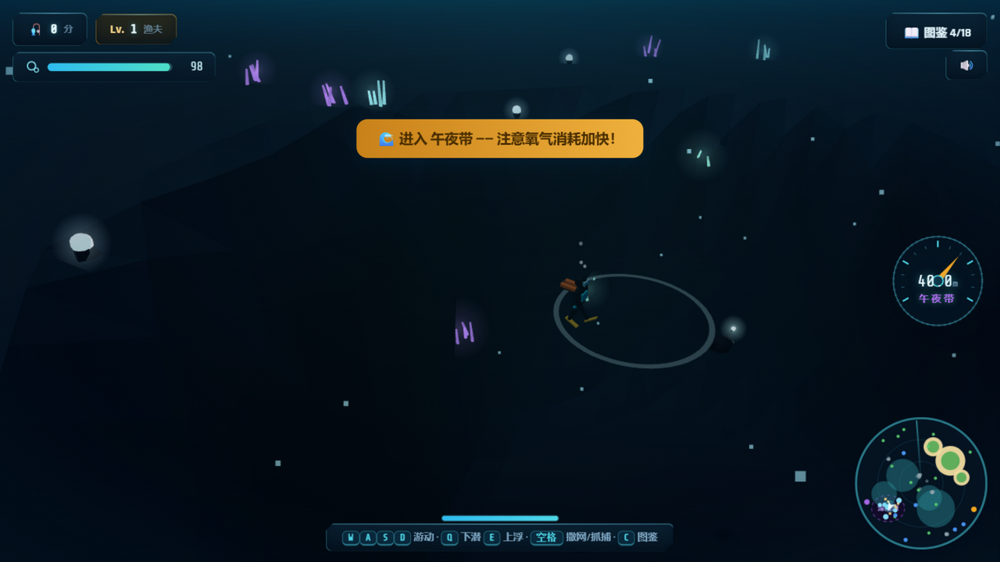

# 🌊 碧海追鱼 · 深海潜水季

一个用 **Three.js** 打造的低多边形（Low-Poly）热带海洋潜水捕捞游戏：扮演潜水员，在珊瑚礁海域游动追逐鱼群、水面撒网、**下潜探索三层深海世界**、徒手抓捕深海生物、采集珍珠，集齐 18 种海洋生物图鉴。




## 🤿 玩法

| 操作 | 按键 | 说明 |
|---|---|---|
| 游动 | `W` `A` `S` `D` / 方向键 | 潜水员自由游动（触屏有虚拟按键） |
| 下潜 / 上浮 | `Q` / `E` | 潜入深海 / 返回水面，注意氧气！ |
| 撒网 / 抓捕 | `空格` | 水面撒网范围大；水下徒手抓捕概率更高 |
| 图鉴 | `C` | 查看 18 种海洋生物收集进度（`Esc` 关闭） |
| 视角 | 滚轮 | 缩放镜头（水下镜头自动拉近平视） |

- **追鱼**：鱼被惊到会狂奔，疲惫减速时是收网良机
- **氧气系统**：水下持续消耗（越深越快），水面快速恢复；耗尽自动紧急上浮；升级增加氧气上限
- **三层深海世界**（西南深海沟，最深 -58m）：
  - 🌞 **阳光带** 0~14m —— 珊瑚礁盘、鱼群、阳光光柱
  - 🌘 **暮光带** 14~32m —— 岩壁台地、深海水母、渐暗蓝光
  - 🌑 **午夜带** 32m+ —— 近黑暗、荧光管珊瑚、生物荧光粒子、头灯探照、沉船地标
- **深海专属生物**：深海水母、灯笼鱼（发光钓竿）、传说大王乌贼（需命中 3 次）；海沟底部还有**深海珍珠** 💠（+30 分）
- **成长**：得分升级渔夫等级——渔网更大、游速更快、氧气更足；最高分与图鉴自动存档

## 🐠 海洋生物（15 捕捞 + 3 采集 = 18）

普通：小丑鱼 · 蓝倒吊 · 黄刺尾鱼 · 银鲳
优良：狮子鱼 · 河豚 · 粉水母
稀有：海龟 · 蝠鲼 · 海豚 · 深海水母 🌊
史诗：章鱼 · 灯笼鱼 🌊
传说：锤头鲨 · 大王乌贼 🌊
采集：海星 · 贝壳 · 深海珍珠 🌊

🌊 = 深海沟专属，需潜水抓捕。右下角声呐小地图实时显示岛屿、鱼群（按稀有度着色）、深海沟区域与传说生物标记。

## 🚀 运行

**在线玩**：[GitHub Pages](https://kircheisa.github.io/myfish/)

**本地运行**（任选其一）：

```bash
# 方式一：任意静态服务器
npx serve .
# 或
python -m http.server 8080

# 方式二：本仓库自带的小服务器
node serve.js   # http://127.0.0.1:8124
```

直接双击 `index.html` 用浏览器打开一般也可运行（需联网从 CDN 加载 three.js / 字体）。

## 🛠 技术要点

单文件实现（`index.html`），仅依赖 CDN 的 three.js r160：

- **水面着色器**：顶点正弦波浪；片元从**预烘焙 16 位高度纹理**（RGBA8 双通道编码 + 手动双线性采样）读取深度，做绿松石→深蓝→午夜色渐变、岸边动态泡沫、阳光碎光、手动雾；DoubleSide 水下可见水面
- **程序化地形**：噪声高度场 + **三级同心阶梯海沟**（最深 -58m），按深度分段着色（礁盘/暮光坡/悬崖岩壁/午夜玄武岩）
- **静态几何合并**：棕榈/木屋/珊瑚/岩石/荧光管珊瑚/沉船按材质合并为整块网格（海草组内合并保留摇曳），draw call ~1300 → ~70
- **潜水系统**：氧气消耗/恢复/紧急上浮、头灯 SpotLight 随深度点亮、水下相机深度混合机位、雾色/光照随深度渐变、呼吸气泡池、阳光光柱、生物荧光粒子
- **鱼群 AI**：群体绕群心游动 + 逃离/疲惫状态机；深海生物 3D 距离感知 + 海沟归巢；水母脉动、海龟划水、蝠鲼扇翼、乌贼触手波动等独立动画
- **游戏手感**：trauma² 创伤震动（分层）、顿帧、白闪、相机速度预瞄、弹出过冲、音效 ±6% 音高抖动
- **UI**：潜水仪表风（斜切角面板 + 青色描边 + 顶部高光）、氧气条、SVG 圆形深度表（刻度/指针/深度带）、声呐小地图（扫描线/网格/海沟标注）、Rajdhani + Share Tech Mono 字体
- **性能**：对象池、相机零每帧分配、dpr 上限 1.5、GPU 高性能偏好

## 📄 许可

[MIT](LICENSE)
