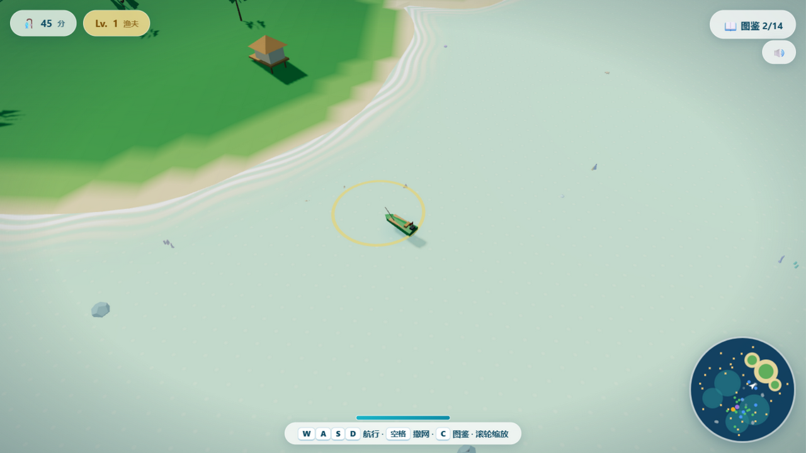

# 🌊 碧海追鱼 · 珊瑚礁捕捞季

一个用 **Three.js** 打造的低多边形（Low-Poly）热带海洋捕鱼游戏：驾驶小船在珊瑚礁海域追逐鱼群、撒网捕捞、采集海星贝壳，集齐 14 种海洋生物图鉴。



## 🎮 玩法

| 操作 | 按键 | 说明 |
|---|---|---|
| 航行 | `W` `A` `S` `D` / 方向键 | 驾驶小船追逐鱼群（触屏设备有虚拟按键） |
| 撒网 | `空格` | 朝船头方向撒网，船前的预览圈变**金色**=有鱼入网 |
| 图鉴 | `C` | 查看 14 种海洋生物收集进度（`Esc` 关闭） |
| 视角 | 滚轮 | 缩放镜头 |

- **追鱼**：鱼被惊到后会狂奔逃跑，逃一阵会**疲惫减速**——那是收网的最佳时机
- **捕捞**：越稀有的生物越容易挣脱；传说级锤头鲨需命中 3 网，出场时有金色光环标记（小地图同步显示）
- **采集**：驶过海星 ⭐ 与贝壳 🐚 自动拾取
- **连捕奖励**：一网捞起多条鱼有额外加分
- **成长**：得分升级渔夫等级，渔网范围与船速随之提升；最高分和图鉴进度自动存档

## 🐠 海洋生物（12 捕捞 + 2 采集）

普通：小丑鱼 · 蓝倒吊 · 黄刺尾鱼 · 银鲳
优良：狮子鱼 · 河豚 · 粉水母
稀有：海龟 · 蝠鲼 · 海豚（会跃出水面）
史诗：章鱼
传说：锤头鲨
采集：海星 · 贝壳

右下角小地图实时显示岛屿、鱼群（按稀有度着色）、采集物与传说生物标记。

## 🚀 运行

**在线玩**：[GitHub Pages](https://kircheisa.github.io/myfish/)

**本地运行**（任选其一）：

```bash
# 方式一：任意静态服务器
npx serve .
# 或
python -m http.server 8080

# 方式二：本仓库自带的小服务器
node serve.js   # http://127.0.0.1:8124
```

直接双击 `index.html` 用浏览器打开一般也可运行（需联网从 CDN 加载 three.js）。

## 🛠 技术要点

单文件实现（`index.html`），仅依赖 CDN 的 three.js r160：

- **水面着色器**：顶点正弦波浪 + 片元按地形深度做绿松石→深蓝渐变、岸边动态泡沫、阳光碎光、手动雾
- **程序化地形**：JS 与 GLSL 共用同一套噪声高度场，水色与海床完全对齐；顶点着色区分深海底/浅滩/沙滩/草地
- **鱼群 AI**：群体绕群心游动 + 个体逃离/疲惫状态机；水母脉动、海龟划水、蝠鲼扇翼、章鱼触手摆动等独立动画
- **场景氛围**：棕榈树、高脚木屋、6 类珊瑚、摇曳海草、漂云、盘旋海鸥、船体随浪起伏、尾流泡沫
- **音效**：WebAudio 实时合成（捕鱼琶音/撒网水花/连捕奖励/升级和弦），可一键静音
- **UI**：玻璃拟态 HUD、Canvas 小地图、生物图鉴、localStorage 持久化存档

## 📄 许可

[MIT](LICENSE)
